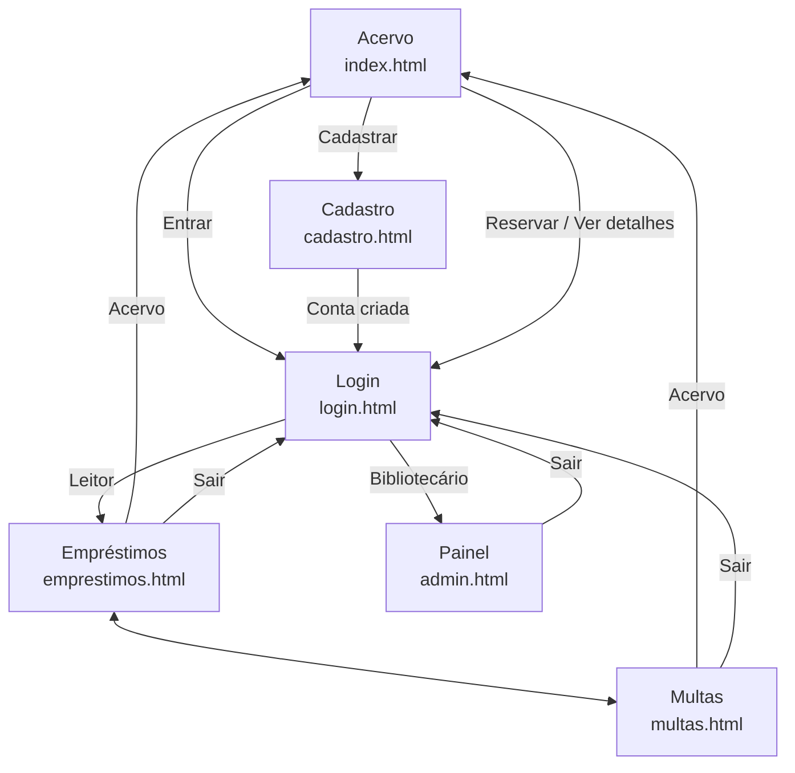

# BiblioQX

Plataforma web de gestão e autoatendimento para a Biblioteca Pública de Quixadá. O sistema permite que os cidadãos consultem o acervo, reservem livros, renovem empréstimos e acompanhem multas de forma remota, e que a equipe da biblioteca gerencie o acervo e os empréstimos.

O BiblioQX não nasceu nesta disciplina. Ele é a continuação de um trabalho iniciado em Requisitos de Software, onde o grupo:

- identificou o problema na Biblioteca Municipal de Quixadá;
- fez o levantamento de requisitos (requisitos de negócio, histórias de usuário, requisitos não funcionais, personas e interfaces externas);
- construiu um protótipo de baixa fidelidade.

Nesta disciplina, a mesma proposta caminha para uma implementação completa e funcional.

## Equipe

| Nome | Matrícula | Curso |
| --- | --- | --- |
| Henrique Mendes da Silva | 567841 | Sistemas de Informação |

Na disciplina de Requisitos de Software o trabalho foi feito por uma equipe de cinco integrantes. Nesta disciplina, o projeto é desenvolvido apenas por mim, Henrique Mendes.

---

## 1. Registro da demanda e dos beneficiários

### Público beneficiado

A **Biblioteca Pública de Quixadá**, equipamento cultural da prefeitura que atende estudantes (UFC, IFCE, UNICATÓLICA e rede pública), leitores em geral e moradores de distritos afastados do centro. Os beneficiados diretos são:

- **Leitores**, que passam a consultar, reservar e renovar sem ir presencialmente à biblioteca;
- **Bibliotecários**, que ganham um controle digital de acervo, empréstimos e multas.

### Interação realizada

A escuta com a comunidade aconteceu durante a disciplina de Requisitos de Software e deu origem aos requisitos que embasam esta proposta:

| Atividade |
| --- |
| Entrevista com a bibliotecária da Biblioteca Municipal de Quixadá |
| Questionário online com usuários da biblioteca |
| Apresentação da proposta e do protótipo ao público beneficiado |

**Necessidades relatadas** (a partir da entrevista e do questionário, conforme o documento de requisitos):

- o controle de empréstimos, devoluções e multas é feito em **fichas físicas**;
- o sistema informatizado existente serve só para catalogação e consulta, e **apresenta instabilidades frequentes**;
- renovações são pedidas por **WhatsApp ou Instagram** e controladas manualmente pelos funcionários;
- o controle de atrasos é manual, demorado e sujeito a falhas, incluindo a **perda de exemplares**;
- o cadastro exige documento de identificação e comprovante de endereço.

### Problema identificado

| Aspecto | Descrição |
| --- | --- |
| Situação atual | Reserva, empréstimo, renovação e multas são registrados à mão, em fichas, e dependem da presença física do leitor ou do contato informal por redes sociais. |
| Público afetado | Leitores (atrasos na reserva e na renovação, dificuldade de saber se o livro está disponível) e funcionários (sobrecarga e erros de registro). |
| Consequências | Perda de controle do acervo, risco à segurança e à integridade dos dados, multas por falta de aviso de prazo e insatisfação dos leitores. |
| Contribuição esperada | Uma plataforma web acessível por computador e celular que automatize reservas, renovações e multas e reduza a dependência de registros manuais. |

Entre as alternativas existentes, o Meu Pergamum é um sistema maduro, mas com design ultrapassado, fluxo de renovação e reserva com muitas etapas e sem disponibilidade para a UFC. O BiblioQX busca uma interface mais simples e direta para o contexto da biblioteca municipal.

### Escopo

**Objetivo:** automatizar os processos de reserva e renovação de livros, reduzindo a necessidade de deslocamento físico para questões burocráticas e melhorando o controle de acervo da biblioteca.

**Funcionalidades essenciais da primeira versão (protótipo):**

- consulta pública ao acervo, com filtros por título, autor, editora e ano
- exibição da quantidade de exemplares disponíveis
- cadastro e login de leitor
- tela de empréstimos ativos, com renovação e histórico
- tela de multas, com valor por livro, total e pagamento
- painel do bibliotecário, com indicadores, empréstimos recentes, registro de devolução e cadastro de livros

**Limitações da primeira versão:**

- o protótipo é **estático**: usa apenas HTML e CSS, sem JavaScript, e os dados exibidos são fictícios;
- não há backend, banco de dados nem autenticação real, e os botões só navegam entre as páginas;
- notificações de prazo (WhatsApp, SMS, e-mail), pagamento digital real, consulta à Open Library e o widget VLibras ficam para etapas futuras;
- o cadastro de leitores é feito pelo formulário, sem o fluxo de validação de documentos que a biblioteca exige hoje.

---

## 2. Planejamento e protótipo Web

### Perfis de usuário

| Perfil | O que pode fazer |
| --- | --- |
| Visitante | Consultar o acervo, ver detalhes e se cadastrar. |
| Leitor | Tudo do visitante, mais reservar, renovar, ver empréstimos, histórico e multas. |
| Bibliotecário | Gerenciar o acervo, registrar saída e devolução e acompanhar o painel. |

### Estrutura das páginas

| Página | Arquivo | Perfil |
| --- | --- | --- |
| Acervo | `index.html` | Público |
| Entrar | `login.html` | Público |
| Cadastro | `cadastro.html` | Público |
| Meus empréstimos e histórico | `emprestimos.html` | Leitor |
| Minhas multas | `multas.html` | Leitor |
| Painel do bibliotecário | `admin.html` | Bibliotecário |

### Fluxo de navegação

Para facilitar o entendimento do funcionamento do sistema, solicitei a IA para construir o fluxo de navegação do sistema e as interações com cada tela.

### Decisões de interface

- **Navegação coerente:** o menu aparece em todas as páginas, com os links funcionando, e o botão **Sair** fica sempre visível nas áreas de leitor e bibliotecário.
- **Identidade visual:** cores extraídas do logo da biblioteca: azul `#2a61a5`, verde escuro `#128460` e verde claro `#6bb650`. O símbolo aparece no menu e o logo completo, na capa e no login.
- **Responsividade:** o layout usa flexbox com quebra de linha, `clamp()` e unidades relativas (`rem`, `%`, `vw`), de modo que os blocos se reorganizam em telas menores.
- **Acessibilidade inicial:** textos alternativos nas imagens, campos de formulário associados a `label`, foco por teclado preservado, contraste de cores adequado entre texto e fundo e mensagens de erro em texto, não só em cor.

### Organização do código

Para visualizar, abra o `index.html` no navegador. Todas as páginas ficam na mesma pasta.

---

## 3. Requisitos

**Requisitos de negócio** (do documento de Requisitos de Software):

- **RN-1:** consultar a disponibilidade e reservar livros de forma remota;
- **RN-2:** eliminar a maior parte do trabalho manual e reduzir o tempo médio de atendimento;
- **RN-3:** gerar relatórios de reservas e empréstimos por gênero, editora e autor;
- **RN-4:** rastrear os livros reservados, para garantir a devolução e reduzir perdas;
- **RN-5:** facilitar o pagamento de multas por meio digital;
- **RN-6:** notificar os usuários sobre datas de devolução próximas;
- **RN-7:** garantir acessibilidade, com tecnologias assistivas.

**Histórias de usuário** (resumo):

| ID | Descrição | No protótipo |
| --- | --- | --- |
| BBQ.UH1 | Como administrador, quero cadastrar livros para atualizar o acervo online. | `admin.html` |
| BBQ.UH2 | Como leitor, quero me cadastrar para usar o serviço. | `cadastro.html` |
| BBQ.UH3 | Como leitor, quero ver os livros cadastrados, com filtros. | `index.html` |
| BBQ.UH4 | Como leitor, quero pagar multas por atraso para regularizar minha situação (R$ 0,50 por dia). | `multas.html` |
| BBQ.UH5 | Como leitor, quero ver meus empréstimos, renovar e devolver pelo sistema (limite de 2 do acervo geral e 2 do infantil). | `emprestimos.html` |
| BBQ.UH6 | Como leitor, quero ver o histórico de empréstimos anteriores. | `emprestimos.html` |

**Requisitos não funcionais** (principais): interface responsiva, recursos de acessibilidade (inclusive para surdos e cegos, com a WCAG), bloqueio após três tentativas de senha incorretas, logout automático após 15 minutos de inatividade e empréstimos visíveis em no máximo 4 cliques. A lista completa está no documento de requisitos.

---

## 4. Proposta de solução

Uma aplicação web responsiva, com três perfis de acesso, que substitui as fichas físicas e o contato informal por redes sociais:

1. **Leitor** consulta o acervo, reserva, renova e acompanha empréstimos e multas pelo celular ou computador.
2. **Bibliotecário** cadastra livros, registra saídas e devoluções e acompanha os indicadores da biblioteca.
3. **Visitante** pode consultar o acervo sem login e se cadastrar quando quiser usar os serviços.
